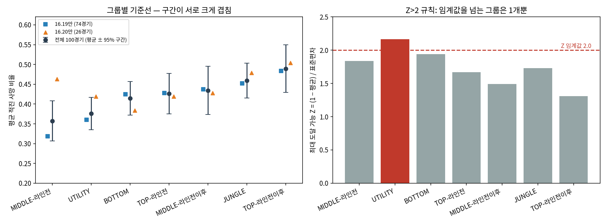

# 롤(LoL) 사망 위치 기반 '적진 사망' 기준선 분석
### — 확정하지 못한 가설, 발견한 구조적 한계, 후속 검증이 필요한 패턴 —

> **읽는 법**: 이 문서는 정답을 제시하는 문서가 아니라, 분석 시도가 어디까지 말할 수 있고 어디부터는
> 말할 수 없는지를 근거와 함께 정리한 문서임. 결과가 가설과 다르게 나왔거나 지나치게 깨끗하게 나온 값에는
> 이유를 달았고(4.4절), 표본·자료가 계획에 못 미친 부분은 3.1절과 7절에 기록함. 어떤 수치도 결과를 보고
> 임계값이나 표본을 바꿔 맞추지 않았음(3.3절). 핵심은 0절과 4절이고, 나머지는 근거 자료임.
>
> **데이터 고지**: 모든 결과는 Riot Match-V5 / League-V4 API로 2026-10-19에 수집한 **실제 솔로랭크
> 경기 데이터**(무작위 표본 100경기)에서 나옴. 이전 가상 데이터 버전과 파일럿(20경기) 수치는 결과의
> 근거로 쓰지 않음(1절).
>
> **AI 활용 고지**: 수집·분석 코드의 작성과 실행, 표 정리, 문서 초안 작성에는 Claude(Anthropic)를
> 활용함. 가설 설계, 재수집 설계 방향(무작위 표본, 기간·패치 정렬), 보고 원칙(불리한 값과 지나치게 깨끗한
> 값에 모두 주석을 달고 한계를 전부 기록), 결과 해석의 최종 판단은 본인이 수행함. 문서 검토에는 다른
> AI(Gemini, ChatGPT)의 의견도 참고했고, 수치와 맞지 않는 표현은 로그에 맞게 수정함. 모든 수치는
> `analysis_logs/`에서 확인할 수 있음.

---

## 0. 한눈에 보기

**질문**: '적진에서 죽었다'는 신호를 모든 포지션에 같은 기준으로 적용하면 오탐이 생길 수 있다는 도메인
지식이 데이터에서도 보이는가? 보인다면 포지션·라인전 단계별 기준선이 이상 사망 후보를 거르는 데 도움이
되는가?

**접근**: 다이아 I~마스터 솔로랭크 무작위 100경기(사망 5,191건)를 수집해 포지션·라인전 단계 7개
그룹의 적진 사망 비율 기준선을 만들고, 가설 검정과 후보 선별 규칙(고정 기준, Z-score, 이항 검정)을
비교함.

| 질문 | 결과 | 근거 강도 |
|---|---|---|
| 그룹별로 적진 사망 정상 기준이 다른가? | 전체 표본 p=0.009이나 데스 4건 이상 표본 p=0.080, 16.20만 보면 p=0.67(모두 관측치 독립을 가정한 값이라 확증 근거로 보지 않음). 그룹 평균 구간이 크게 겹침 | **약함 — 판단 보류** |
| 라인전 이후 적진 사망이 늘어나는가? | 탑은 세 범위 모두 같은 방향이나 모두 유의수준 미달. 미드는 16.19에서만 뚜렷하고(사후 분석) 16.20에서는 반대 방향 | **약함 — 미확정** |
| 파일럿의 '원딜 최저'가 재현되는가? | 전체·16.19에서는 중간(3위), 16.20에서만 최저 | **재현되지 않음** |
| Z>2 규칙으로 이상 후보를 뽑을 수 있는가? | 이 지표에서는 거의 불가능. 7개 그룹 중 6개와 통합 기준선의 최대 Z가 2 이하 | **확인된 사실(이 데이터 한정)** |
| 우연보다 많은 극단 사례가 있는가? | 이항 검정 플래그 7건 vs 우연 기대 약 6.5건 | **근거 없음** |
| (탐색) 팀 맥락이 사망의 적진 여부와 관련돼 보이는가? | 팀-경기 ICC 0.10, 동료와의 상관 +0.49. 포지션 그룹 ICC(0.006)와는 직접 비교할 수 없음 | **탐색적 — 후속 탐색의 단서일 뿐, 새 표본 확인 필요** |
| (탐색) 같은 팀 동료가 ±30초 안에 함께 죽었는지에 따라 적진 비율이 다른가? | 비동반 0.462 vs 동반 0.367 (차이 +0.095, 95% 구간 +0.064~+0.127) | **탐색적 — 시간·포지션 구성 미보정** |

**이 프로젝트에서 얻은 것**
1. 가설은 확정하지 못했고, 무엇이 왜 확정되지 않는지(표본, 선택 효과, 패치, 정답 라벨 부재)를 기록함.
2. 비율 지표(평균 약 0.4, 표준편차 0.3~0.4)에 Z>2를 적용하면 상한(1.0) 때문에 후보가 거의 나오지 않는다는
   구조적 한계를 수식과 데이터로 확인함.
3. 작은 표본·비무작위 표본으로 낸 파일럿 결과가 재수집에서 재현되지 않는 것을 관찰함.
4. 같은 질문을 더 큰 표본에서 다시 던질 수 있는 수집·분석 코드와 로그를 남김.

---

## 1. 문제 정의와 경과

KDA 같은 단일 지표만으로 트롤 플레이를 판단하는 방식의 한계를 보완하려고 사망 시점과 좌표를 함께 보는 데서
출발함. 분석을 진행하면서 실제로 구현된 것은 '적진 사망'이라는 단일 지표에 포지션·라인전 단계 구분을 더한
것이고, 이것만으로 트롤 여부를 판별할 근거는 제한적임을 확인해 목적을 조정함.

- (변경 전) 좌표·시간 정보를 활용한 트롤탐지 정확도 향상
- (변경 후) 포지션·라인전 단계별 기준선 가설의 통계적 검증과 후보 선별 규칙의 한계 파악

**파일럿(20경기)과 재수집**: 이전 README는 특정 소환사 중심으로 수집한 20경기 결과였으나 원본 CSV가 소실되어
재현할 수 없음. 재현할 수 없는 수치를 근거로 남기지 않기 위해 재수집한 새 표본으로 다시 분석함. 이전 기록은
비교용으로만 둠.

| 항목 | 파일럿 기록 (원본 소실, 재현 불가) | 재수집 결과 |
|---|---|---|
| 그룹 간 차이 검정 (Kruskal-Wallis) | p=0.552 (비유의) | p=0.009 (전체 표본) / 0.080 (데스 4건 이상 표본) |
| 평균이 가장 낮은 그룹 | BOTTOM (0.374) | MIDDLE-라인전 (0.357), BOTTOM은 3위 (0.414) |
| 고정 70% vs Z>2 플래그 | 29건 vs 1건 | 83건 vs 1건 |

두 표본은 크기만 다른 것이 아니라 수집 방식(특정 소환사 중심 vs 무작위), 티어 범위(다이아 IV~II로 기억함,
확인 불가), 기간도 달랐음. 따라서 '소표본이라 불안정했다'는 것은 가능한 설명 중 하나일 뿐 이 비교로 입증되지
않음. 이 불일치는 **소표본·비무작위 표본으로 낸 결론의 취약성을 보여주는 관찰**로만 기록함.

---

## 2. 가설

| 포지션 | 가설 |
|---|---|
| 정글 / 서포터 | 시야 장악, 카운터정글, 침투 플레이 등으로 적진 사망이 상시 잦음 |
| 탑 / 미드 | 라인전(~15분) 중에는 적진 사망이 드물고, 이후 로밍·사이드 운영으로 늘어남 |
| 원딜 | 팀 자원이 집중되고 라인 제약이 커 적진 사망이 상대적으로 드묾 |

검정 가능한 6개 가설(단측): **H1** BOTTOM < TOP-라인전이후, **H2** BOTTOM < MIDDLE-라인전이후,
**H3** TOP 라인전 < 라인전이후, **H4** MIDDLE 라인전 < 라인전이후, **H5** JUNGLE > BOTTOM,
**H6** UTILITY > BOTTOM. H1~H4는 파일럿 가설이고 H5~H6은 위 표의 정글/서포터 가설 중 파일럿에서 검정하지
않았던 항목으로, 분석 스크립트를 처음 실행하기 전에 목록에 포함함.

---

## 3. 데이터와 방법

### 3.1 수집 설계와 계획 대비 실제

- **모집단**: 솔로랭크(queueId 420), 다이아몬드 I ~ 마스터(수집 시점 래더 기준)
- **주 표본**: 래더에서 무작위로 뽑은 소환사의 경기(소환사당 최대 2경기, 본인 참여 경기·중복 경기 제외)
- **기간**: 본인 마지막 솔로랭크 경기 종료 시각 기준 이전 14일(2026-09-24 16:52 ~ 10-08 16:52 UTC)
- **개인정보**: puuid는 솔트 해시로만 저장, 닉네임은 저장하지 않음

| 항목 | 계획 | 실제 | 비고 |
|---|---|---|---|
| 무작위 표본 | 100경기 | **100경기** | 달성 |
| 본인 계정 검증 표본 | 30경기 | **5경기** | 기간 내 솔로랭크가 5경기뿐 → **분석에서 제외** |
| 패치 | 단일 패치 | **16.19(74경기)·16.20(26경기) 혼재** | 기간 중 패치 전환 → 패치별 결과 병기 |
| 소환사 풀 | 다이아 I~마스터 | 다이아 I 12,300명·마스터 10,000명 | 마스터가 **정확히 10,000명** → API 상한 가능성, **미확인** |
| 소환사당 경기 | 최대 2 | 최대 2 | 충족 |
| 제외된 경기 | — | 다시하기·짧은 경기 2경기 | 수집 로그에 기록 |

### 3.2 표본 흐름 — 숫자들의 관계

| 단계 | 개수 | 설명 |
|---|---|---|
| 수집 파일의 경기 | 105 | 무작위 100 + 본인 계정 5 |
| 분석에 쓴 경기 | **100** | 본인 5경기 제외 |
| 분석에 쓴 사망 이벤트 | **5,191** | 수집 파일 전체는 5,524(본인 경기 333건 포함) |
| 분석 표본 | **1,245** | (경기, 참가자, 그룹) 단위의 적진 사망 비율 |
| 데스 4건 이상 표본 | **653** | 분석 표본 중 데스가 4건 이상인 것. 소표본 노이즈를 줄이려는 기준일 뿐 신뢰성을 보장하는 조건이 아님. 그룹별 잔존율 32~77%(아래 주의) |

**주의 — 데스 4건 이상 표본의 선택 효과**: 데스 4건 이상 조건은 그룹마다 남는 비율이 크게 다름(BOTTOM 77%,
UTILITY 72%, JUNGLE 62%, 탑·미드의 라인전이후 40%, TOP-라인전 36%, MIDDLE-라인전 32%). 라인전 구간은
시간이 짧아 데스가 적기 때문. 따라서 데스 4건 이상 표본으로 그룹을 비교하면 '소표본 노이즈 제거'와 함께 '그룹마다
다른 선택'이 섞임.

### 3.3 분석 정의와 파라미터 출처

- **적진 사망**: 사망 지점이 자기 베이스보다 적 베이스에 더 가까움(베이스 좌표는 공개 맵 데이터 근사)
- **그룹**: 포지션 5개, 탑/미드는 15분(900초) 기준으로 라인전/라인전이후로 나눠 총 7개
- **기준선**: 그룹별 평균·표준편차(모표준편차). **최대 Z** = (1 − 평균) / 표준편차 (비율의 상한이 1.0이므로
  이 값이 2 이하이면 그 그룹은 Z>2로 플래그될 수 없음)

| 파라미터 | 값 | 출처 | 이번 데이터로 조정했는가 |
|---|---|---|---|
| 라인전 경계 | 900초 | 파일럿 가정 | 아니오(경계 민감도는 부록 B) |
| 표본 포함 기준(데스 4건 이상 표본) | 데스 4건 이상 | 파일럿 설정 | 아니오 |
| 고정 기준(비교용) | 70% | 파일럿 예시 값 | 아니오(민감도는 부록 B) |
| Z 임계값 / 유의수준 | 2.0 / 0.05 | 관례 | 아니오 |
| 가설 6개 | H1~H6 | 2절 | 결과를 보고 추가·삭제하지 않음 |
| 패치별 분석, 이항 검정, 과산포, 5절 탐색 | — | **결과를 본 뒤 추가한 사후(탐색적) 분석** | 해당 절에 '사후'로 표기 |

### 3.4 검증 범위

기존 SQL(`lol_troll_detection_real.sql`)과 파이썬 분석에서 그룹별 표본 수·평균·표준편차가 완전히
일치함. 이는 **구현 오류를 잡는 검증**이며, 두 구현이 같은 정의(적진 판정, 그룹, 분모)를 공유하므로
정의 자체가 맞는지까지 보증하지는 않음. 수집 코드는 가짜 API로 조건 준수 여부를 테스트했고 실제
API는 1회 실행해 성공했으나, 실제 응답 형식이 바뀌는 경우까지 검증한 것은 아님.

---

## 4. 핵심 결과

### 4.1 그룹별 기준선 (전체 100경기, 표본 1,245개)

| 그룹 | 표본수 | 평균 적진 사망 비율 | 표준편차 | 최대 Z |
|---|---|---|---|---|
| MIDDLE-라인전 | 182 | 0.357 | 0.350 | 1.84 |
| UTILITY | 194 | 0.376 | 0.288 | **2.17** |
| BOTTOM | 193 | 0.414 | 0.302 | 1.94 |
| TOP-라인전 | 174 | 0.426 | 0.344 | 1.67 |
| MIDDLE-라인전이후 | 149 | 0.434 | 0.380 | 1.49 |
| JUNGLE | 192 | 0.459 | 0.312 | 1.73 |
| TOP-라인전이후 | 161 | 0.489 | 0.390 | 1.31 |

전체 통합 기준선: 평균 0.421, 표준편차 0.339, 최대 Z 1.71.



그룹 평균의 95% 구간이 크게 겹치고, 그룹 사이 차이(최대 약 0.13)는 표준편차(0.29~0.39)에 비해 작음.
방향(라인전 이후 탑/미드가 높고 미드 라인전이 가장 낮음)은 가설과 맞지만 그룹을 뚜렷이 구분해 주지는 못함.

### 4.2 가설 검정

- Kruskal-Wallis(7개 그룹): 전체 표본 **p=0.0090**, 데스 4건 이상 표본 **p=0.0803**, 16.19 0.0029
  / 16.20 0.6732(전체 표본 기준)

| ID | 가설 | 평균 a | 평균 c | p | Holm 보정 p (6개) |
|---|---|---|---|---|---|
| H1 | BOTTOM < TOP-라인전이후 | 0.414 | 0.489 | 0.0662 | 0.312 |
| H2 | BOTTOM < MIDDLE-라인전이후 | 0.414 | 0.434 | 0.4905 | 0.981 |
| H3 | TOP 라인전 < 이후 (독립 가정, 참고용) | 0.426 | 0.489 | 0.0983 | 0.312 |
| H4 | MIDDLE 라인전 < 이후 (독립 가정, 참고용) | 0.357 | 0.434 | 0.0428 | 0.257 |
| H5 | JUNGLE > BOTTOM | 0.459 | 0.414 | 0.0624 | 0.312 |
| H6 | UTILITY > BOTTOM | 0.376 | 0.414 | 0.8722 | 0.981 |

라인전 전/후 대응 검정(Wilcoxon, 같은 경기·선수):

| 범위 | 포지션 | 짝 수 | 라인전 → 이후 평균 | p | Bonferroni 보정 p (2개) |
|---|---|---|---|---|---|
| 전체 100경기 | TOP | 143 | 0.411 → 0.473 | 0.0850 | 0.170 |
| 전체 100경기 | MIDDLE | 138 | 0.345 → 0.418 | 0.0388 | 0.078 |
| 16.19 (사후) | MIDDLE | 98 | 0.302 → 0.418 | 0.0087 | 0.017 |
| 16.20 (사후) | MIDDLE | 40 | 0.451 → 0.416 | 0.6630 | — (반대 방향) |

※ 16.19·16.20 행은 결과를 본 뒤 패치를 나눠 추가한 **사후(탐색) 분석**임. 'Bonferroni 보정 p (2개)'는 해당
범위의 TOP·MIDDLE 두 검정만 묶어 보정한 값이며, 패치를 나눈 선택 자체와 이 문서에서 실제로 본 다른 분할·탐색
(전체·16.19·16.20 비교, 이항 검정, 5절)은 보정에 포함되지 않음. 따라서 16.19 미드의 p=0.0087(보정 0.017)은
확증된 유의성이 아니라 후속 검증 대상인 탐색 결과이며, 16.20에서 반대 방향이 나온 점과 함께 읽어야 함.

해석
- 6개 가설 중 보정 전 p<0.05는 H4 하나이고, Holm 보정 후에는 모두 유의하지 않음. 방향은 가설과 대체로
  같지만(H1, H3, H4, H5) **통계적 근거는 약함**. H6(서포터가 높다)은 반대 방향으로 나옴.
- 탑의 '라인전 이후 증가'는 전체·16.19·16.20에서 모두 같은 방향이나 어디서도 유의하지 않음. 미드는 16.19에서만
  뚜렷하고 16.20에서는 반대여서 일관성이 없음. 16.19의 p=0.0087은 패치를 나눠 본 사후 분석의 값임.
- **독립성과 p값의 해석 한계**: 이 절의 모든 p값은 (경기, 참가자, 그룹) 표본이 서로 독립이라는 가정으로
  계산됨. 실제로는 ① 같은 경기·같은 팀의 표본이 서로 닮아 있고(5절의 ICC·동료 상관), ② 같은 참가자가
  '라인전'과 '라인전이후' 그룹에 모두 들어가 H3·H4와 Kruskal-Wallis의 그룹이 겹치며, ③ 같은 소환사의 경기가
  최대 2개, 일부 참가자가 중복됨(7절). **팀·경기를 묶음으로 반영한 검정은 수행하지 않았음**(경기 단위
  부트스트랩은 5절의 구간 추정에만 사용). 이 때문에 p값이 얼마나, 어느 방향으로 틀어졌는지는 현재 자료로
  판단하지 못함. 따라서 전체 표본 Kruskal-Wallis p=0.009를 그룹 차이의 확증 근거로 쓰지 않고, 데스 4건 이상
  표본(0.080)·16.20(0.67)에서 값이 달라지는 점과 함께 '그룹 차이가 있을 수 있다는 약한 단서'로만 해석함. 이 절의
  p값은 모두 탐색적 요약 지표로 읽어야 함.
- **데스 4건 이상 표본에서 p가 커진 이유**: 소표본 노이즈 제거와 3.2절의 그룹별 선택 효과가 섞여 있어 어느 쪽 때문인지
  분리하지 못함. 두 결과를 모두 보고함.

### 4.3 후보 선별 규칙 비교 (데스 4건 이상 표본 653개)

| 방식 | 플래그 건수 | 비고 |
|---|---|---|
| 고정 기준 (적진 사망 70% 이상) | 83건 (12.7%) | 정답 라벨이 없어 '정상'인지 알 수 없음 |
| 전체 통합 기준선 Z>2 | 0건 | 최대 Z 1.71이라 플래그 불가 |
| 그룹 기준선 Z>2 | 1건 | UTILITY, 데스 4건 전부 적진 |
| 이항 검정(그룹 확률, α=0.01, 사후) | 7건 | 우연 기대 약 6.5건 |

- **Z>2의 한계는 이 지표의 성질에서 나옴**: 평균이 0.4 안팎이고 표준편차가 0.3~0.4로 큰 비율에서는
  (1 − 평균)/표준편차가 2 근처에 묶임. 평균이 매우 낮은 비율 지표라면 같은 규칙이 작동할 수 있으므로 '비율
  데이터 일반'이 아니라 이 지표에 한정한 결론임. 규칙이 쓸모없는 것은 아니고(UTILITY는 가능, 임계값을
  1.5로 낮추면 그룹 15건·통합 19건) 임계값과 분산 구조를 보고 설계해야 한다는 교훈임.
- 포지션을 반영해도 플래그 대상은 거의 같았음(이항 검정 α=0.05: 그룹만 3 / 통합만 6 / 공통 34).
- 과산포(분산비 1.53)가 있어 이항 검정은 참고용임.
- 플래그된 사례는 전체 1건, 16.19 3건, 16.20 1건이며 모두 비율 100%임. **리플레이로 확인하지 않았음.**

### 4.4 '왜 이런 값이 나왔나' — 값별 주석

| 눈에 띄는 결과 | 왜 이렇게 나왔는가 | 임의 수정 여부 |
|---|---|---|
| 통합 기준선 Z>2 플래그 **0건** (지나치게 깨끗한 0) | 데이터가 깨끗해서가 아니라 최대 Z가 1.71이라 이 지표에서 구조적으로 불가능하기 때문 | 임계값·표본 불변, 민감도 공개 |
| 16.19에서 MIDDLE-라인전 최대 Z **2.03**(겨우 2 초과) | 패치에 따라 평균이 0.357 → 0.318로 낮아져 '불가'가 '가능'으로 바뀜. 규칙이 평균의 작은 변화에 취약함을 보여줌 | 그대로 보고 |
| H6 p=**0.87** | 단측 검정에서 반대 방향이면 p가 1에 가까워짐. 서포터(0.376)가 원딜(0.414)보다 낮아 가설과 반대로 나온 것이며 오류가 아님 | 가설 불변, '지지되지 않음'으로 보고 |
| 16.19 미드 p=**0.0087** (가장 깨끗한 값) | 결과를 본 뒤 나눈 사후 부분집합의 값이고, 보정 p=0.017도 TOP·MIDDLE 2개만 묶은 것이라 패치 선택과 다른 탐색은 반영하지 않음. 16.20에서는 반대 방향. 확증 근거로 쓰지 않음 | 병기, 탐색적으로 표기 |
| Kruskal-Wallis가 0.009 / 0.080 / 0.67로 **들쭉날쭉** | 소표본 노이즈, 데스 4건 이상 표본의 선택 효과, 16.20의 낮은 검정력이 섞임. 어느 쪽이 '진짜'인지 단정할 수 없음 | 유리한 값만 고르지 않고 모두 보고 |
| 고정 70% 플래그 83건(12.7%) | 임계값에 좌우되는 수치이고 정답 라벨이 없어 오탐 83건이라는 뜻이 아님 | 예시 값 불변 |
| 이항 검정 7건 ≈ 우연 기대 6.5건 | 두드러진 극단 사례를 확인하지 못함. 다만 과산포와 작은 표본 때문에 '이상 사례가 없다'는 증거도 아님 | 사후 분석으로 표기, 해석 보류 |
| 파일럿의 '원딜 최저'가 재현 안 됨 | 소표본의 우연일 수 있으나 수집 방식·티어·기간도 달라 원인 분리 불가. 16.20만 보면 최저(26경기) | 파일럿 수치를 근거로 쓰지 않음 |
| 마스터 풀 **정확히 10,000명** | API 응답 상한일 수 있으나 확인하지 못함 | 확인 전까지 '마스터 전체'라고 쓰지 않음 |
| 경기 단위 ICC가 **≈0**, 그룹 ICC **0.006** | 그룹은 사망 하나하나의 적진 여부를 거의 설명하지 못함. 경기 단위 0은 한 팀의 적진 사망이 상대에게는 자기 진영 사망이라 두 팀이 상쇄되기 때문으로 **추정**(팀 단위는 0.10). 두 ICC의 비교는 5절 참고 | 정의·표본 불변 |

---

## 5. 탐색적 관찰 (사후 분석 — 새 표본에서 확인 필요)

그룹 기준선이 뚜렷한 구분력을 보이지 못한 뒤 같은 자료에서 다른 변동 요인을 살펴봄. 여러 항목을 본 사후
분석이므로 p값 대신 효과 크기와 경기 단위 부트스트랩 구간을 보고하며, 이 구간은 다중 탐색을 보정한 것이
아님. 패치별(16.19/16.20) 방향은 같은 100경기를 나눈 것이라 독립 재현은 아님.
(`explore_context_effects.py`, `analysis_logs/explore_context_*.txt`)

**① 팀-경기 묶음의 ICC가 0과 구별되는 크기로 나옴 (포지션 그룹 ICC와는 직접 비교할 수 없음)**

| 묶음 단위 | ICC | 95% 구간 (경기 부트스트랩) |
|---|---|---|
| 포지션·라인전 그룹 (7개) | 0.006 | — |
| 경기 | 0.003 | −0.003 ~ 0.008 |
| 팀-경기 | 0.102 | 0.074 ~ 0.131 |
| 선수-경기 | 0.114 | 0.083 ~ 0.146 |

선수-경기 적진 사망 비율과 같은 팀 동료의 비율의 Spearman 상관은 +0.49(무작위로 섞으면 ±0.07 범위, 패치별
+0.51 / +0.39). 상대 팀과는 −0.49인데, 위치로 정의한 지표라 한 지점의 사망이 한 팀에는 '적진', 상대에게는
'자기 진영'이 되므로 이 음의 상관은 일부 기계적임. ICC(사망 단위)와 상관(표본 단위)은 단위가 달라 크기를
직접 비교하거나 분해할 수 없음.

**두 ICC의 직접 비교는 하지 않음**: 포지션 그룹 ICC(묶음 7개)와 팀-경기 ICC(묶음 약 200개)는 묶음 수·묶음
크기·분산 구성이 달라 같은 잣대로 볼 수 없고, 그룹 ICC는 묶음이 7개뿐이라 추정이 불안정해 구간도 계산하지
않았음. 따라서 '팀 맥락이 포지션보다 더 중요하다'고 결론내리지 않음. 여기서 말할 수 있는 것은 팀-경기 ICC의
구간이 0을 벗어나고 동료와의 상관도 뚜렷하므로 **팀 맥락(그 경기에서 팀이 어디서 싸웠는지)이 후속 탐색의
단서**라는 정도임. 포지션 그룹의 ICC가 작은 것도 포지션이 무의미하다는 뜻이 아니라 사망 하나하나의 변동이
커서 평균 차이가 묻히는 것일 수 있음.

**② 같은 팀 동료가 ±30초 안에 함께 죽었는지에 따른 차이**

| 창(초) | 비동반 비중 | 적진 비율(동반) | 적진 비율(비동반) | 차이 | 95% 구간 |
|---|---|---|---|---|---|
| 20 | 0.382 | 0.364 | 0.443 | +0.079 | +0.050 ~ +0.108 |
| **30** | 0.283 | 0.367 | 0.462 | **+0.095** | +0.064 ~ +0.127 |
| 45 | 0.184 | 0.374 | 0.482 | +0.108 | +0.069 ~ +0.147 |
| 60 | 0.126 | 0.381 | 0.485 | +0.105 | +0.058 ~ +0.149 |

- 이 지표가 측정하는 것은 **'같은 팀 다른 선수의 사망이 시간상 가까운가'**이지 실제로 혼자 행동했는지(고립)
  또는 교전 중이었는지가 아님. 같은 시간대에 팀 다른 곳에서 동료가 죽었어도 '동반'이 되고, 사망이 많은
  후반일수록 우연히 동반이 될 확률이 높아짐. **게임 시간과 포지션 구성은 보정하지 않았으므로** 차이의 일부는
  구성 차이일 수 있음(포지션 묶음 안에서는 같은 방향: 바텀/서포터 0.353 → 0.399, 정글 0.394 → 0.551,
  탑/미드 0.372 → 0.473).
- 이 결과만으로 '이상 행동 후보를 더 잘 거를 수 있다'고 말할 수 없음. 정답 라벨과 기존 규칙 대비 성능 평가가
  없기 때문임.

**폐기한 분석·해석**
- 기준 확률(전체·그룹·경기·팀)별 과산포 분산비 비교: 사망 수가 적은 팀·경기 단위 확률은 추정 잡음이 분산비를
  부풀려 공정한 비교가 아니었음. 결론에 쓰지 않음.
- '고정 70% 플래그 표본의 적진 사망 365건 중 66%가 동반 사망이므로 팀 교전으로 설명된다'는 해석: 검토
  과정에서 **적진 사망 전체 중 동반 비중이 66.8%(1,367/2,046)로 같고**, 비플래그 데스 4건 이상 표본(71.2%)보다 오히려
  낮아 플래그 표본을 구분하는 근거가 되지 못함을 확인해 폐기함.

그 밖의 탐색 결과(정글의 시간대별 비율, 라인전 경계 민감도, 경기 길이·진영)는 부록 B에 둠.

---

## 6. 해석과 실무적 활용 (잠정)

**말할 수 있는 것**
- 고정 기준(70%)은 데스 4건 이상 표본의 약 13%를 플래그하고 Z>2 규칙은 사실상 아무도 플래그하지 못함. 두 방식이
  양 극단에 있어 중간 지점의 규칙(건수를 반영하는 방식 등)을 검토할 필요가 있음.
- 포지션별 기준선이 이득이라는 점은 이번 표본으로 입증하지 못함.
- 팀 맥락과 시간상 동반 여부는 후속 검증 가치가 있는 후보 변수임(탐색적).

**말할 수 없는 것**
- 포지션 기준선이 오탐을 줄인다는 주장, 특정 규칙이 이상 행동 탐지를 개선한다는 주장
  (정답 라벨 부재), 유저 이탈과의 연결(측정하지 않음)

**활용 제안**: 이런 규칙의 출력은 제재 근거가 아니라 **사람이 검토할 후보 목록**으로 쓰고, 검토 결과를 정답
라벨로 쌓아 후보 목록의 정밀도와 검토 비용으로 규칙을 평가하는 순서를 권장함.

---

## 7. 한계와 다음 단계

**결론에 영향을 주는 한계**

| 한계 | 왜 생겼나 | 지금 한 대응 | 다음 단계 |
|---|---|---|---|
| 표본 크기 부족(검정력) — 그룹당 149~194개, 패치별로는 더 작음 | 호출 한도와 준비 기간 | 패치별·데스 4건 이상 표본별 병기, 방향만 해석 | 300경기 이상, 단일 패치로 재수집 |
| 정답 라벨 없음 | 제재·신고 기록 접근 불가 | 정밀도·재현율 미산출 | 플래그·상위 후보를 리플레이로 검토해 소규모 라벨링 |
| 데스 4건 이상 표본의 그룹별 선택 효과, 소표본 노이즈 | 데스 4건 기준이 그룹마다 다르게 걸러냄 | 전체·데스 4건 이상 표본 병기 | 선수별 사망 합산 또는 건수 가중 모형(베타-이항 등) |
| 패치 2개 혼재(16.20은 26경기), 본인 검증 표본 5경기 | 기간 중 패치 전환, 기간 내 경기 부족 | 본인 표본 제외·기록, 패치별 병기 | 별도 무작위 배치를 검증 표본으로 수집 |
| 적진 판정이 단순함(베이스 거리 비교) | 맵 구역 데이터 미사용 | 한계로 기록 | 맵 구역 기반 판정과 비교 |
| 마스터 풀 10,000명 상한 의심 | 응답 건수 미확인 | 모집단을 '수집된 풀'로 한정 | 응답 건수 확인, 필요시 분할 수집 |

**참고 한계(포트폴리오 수준에서 허용 가능)**

| 한계 | 설명 | 다음 단계 |
|---|---|---|
| 표본 독립성 위반 | 같은 소환사 최대 2경기, 일부 참가자 중복(63/899명), 같은 팀·경기 표본의 상관. 군집 반영 검정은 미수행이라 p값에 미친 영향의 크기·방향은 판단하지 못함(4.2절) | 팀 단위 묶음 검정, 경기 단위 군집 부트스트랩 |
| 사후 분석·다중 탐색 | 패치별, 이항 검정, 5절은 결과를 본 뒤 추가. 구간은 보정되지 않음 | 가설을 사전에 고정하고 새 표본에서 확증 |
| 동반 사망 정의가 거침 | ±30초 이내 동료 사망, 시간·포지션 미보정 | 킬 참여자 기반 교전 단위로 재정의 |
| 티어 시점 불일치 | 티어는 수집일(10-19), 경기는 9/25~10/8 | 경기 직후 티어 수집 |
| 일반화 범위 | 단일 서버(KR), 약 2주, 고티어 | 다른 티어·기간으로 확장 |
| 재현성 | 래더 스냅샷 기반이라 다시 수집하면 다른 표본 | CSV·로그를 저장소에 고정 |

---

## 8. 결론

**가설이 확정되었는가?** 아니오. 포지션·라인전 단계별 적진 사망 기준이 다르다는 가설은 방향은 대체로
맞지만 통계적 근거가 약하고 표본 구성과 패치에 따라 달라짐. 이는 가설이 틀렸다는 기각이 아니라 이 표본으로
**확정할 수 없다**는 결론임.

**그럼에도 남은 것**: ① 이 지표에서 Z>2 규칙이 구조적으로 작동하기 어렵다는 점 확인, ② 팀 맥락(팀-경기 ICC 0.10, 동료와의 상관)이
사망의 적진 여부와 관련돼 보인다는 탐색적 단서(포지션 그룹 ICC와 직접 비교할 수 없고, 새 표본에서 확인 필요), ③ 소표본·비무작위 표본 결론의 취약성
관찰, ④ 같은 질문을 더 큰 표본에서 재검증할 수 있는 파이프라인.

| 보여주는 것 | 근거 | 한계 |
|---|---|---|
| 재현 가능한 수집·분석 | 호출 제한 준수, 캐시, 기간·패치 정렬, 겹침·중복 제거, 해시 처리, 가짜 API 테스트, SQL·파이썬 결과 대조 | 코드 작성은 Claude와 협업. 실제 응답 형식 변경 검증 없음 |
| 불리한 결과의 정직한 보고 | 4.4절 주석, 7절 한계, 폐기한 분석 공개 | — |
| 근거 강도를 구분하는 해석 | 0절 표, 사후 분석 표기 | 정답 라벨이 없어 탐지 성능은 미검증 |

---

## 부록 A. 통계 용어 (쉬운 설명)

- **비모수 검정**: 값이 0~1 비율이고 표본이 작아 정규분포를 가정하기 어려워 쓰는 검정(Kruskal-Wallis,
  Mann-Whitney U, Wilcoxon).
- **Kruskal-Wallis**: 여러 그룹의 값이 모두 같은 분포에서 나왔다고 봐도 되는지 한 번에 확인.
- **Mann-Whitney U**: 두 그룹을 비교해 한쪽이 더 크다고 볼 수 있는지 확인(두 그룹이 독립이라고 가정).
- **Wilcoxon 대응표본 검정**: 같은 선수의 '라인전'과 '이후'처럼 짝지어진 값을 비교.
- **p-value**: 귀무가설(예: 그룹 간 차이 없음)과 검정에 쓴 모형의 가정(예: 관측치끼리 독립)이 모두 성립한다고
  가정했을 때, 관찰된 결과만큼 또는 그보다 극단적인 검정통계량이 나올 확률. 귀무가설이 참일 확률이나 결과가
  우연일 확률이 아니며, 효과의 크기나 실질적 중요성을 뜻하지도 않음. 가정(독립성 등)이 깨지면 값 자체가 달라질 수
  있음.
- **다중비교 보정**: 같은 자료로 여러 번 검정할 때 우연히 유의해질 확률을 막으려 기준을 엄격하게 하는 절차
  (6개 가설은 Holm, 라인전 대응 검정 2개는 Bonferroni로 함께 보고). 보정은 묶은 검정에만 적용되며, 결과를 본 뒤
  나눈 패치나 그 밖의 탐색까지 포함하지는 않음.
- **과산포**: 선수-경기 사이 변동이 순수한 우연(이항 분포)이 예상하는 것보다 큰 정도. 1보다 크면 우연
  이상의 변동.
- **ICC(집단내 상관)**: 같은 묶음 안의 사망이 서로 얼마나 닮았는지(0~1). 묶음 수·크기가 다른 ICC끼리는 직접
  비교하기 어렵고, 묶음이 적으면 추정이 불안정함.
- **동반/비동반 사망**: 같은 팀 다른 선수가 ±30초 안에 사망했는지 여부(시간상 가까움만 측정).

## 부록 B. 보조 탐색 결과 (모두 사후, 탐색적)

**정글의 시간대별 적진 사망 비율**

| 포지션 묶음 | <10분 | 10~20분 | 20분+ |
|---|---|---|---|
| JUNGLE | 0.516 (n=244) | 0.416 (n=389) | 0.378 (n=299) |
| TOP/MID | 0.397 | 0.420 | 0.413 |
| BOT/SUP | 0.362 | 0.364 | 0.360 |

정글은 패치별로도 같은 방향으로 감소(16.19 0.524 → 0.404, 16.20 0.500 → 0.290). 2절의 '정글 상시 높음'은
'초반에 높음'에 가까워 보이나 9칸을 본 사후 관찰임.

**라인전 경계(15분) 민감도 — TOP+MIDDLE 이벤트 기준 (이후 − 이전)**

| 경계(초) | 차이 | 95% 구간 |
|---|---|---|
| 600 | +0.020 | −0.028 ~ +0.066 |
| 720 | +0.036 | −0.003 ~ +0.076 |
| 900 | +0.051 | +0.012 ~ +0.092 |
| 1080 | +0.015 | −0.024 ~ +0.055 |
| 1200 | +0.003 | −0.041 ~ +0.044 |

사전에 정한 900초에서 차이가 가장 크지만 다섯 경계 중 최대값이라 구간이 낙관적일 수 있고 크기도 +5%p
수준임. 시간대 전체로는 적진 사망 비율이 거의 평평함(사망 시각과의 Spearman ρ=−0.008).

**경기 길이·진영**: 경기 길이와 경기별 적진 사망 비율의 Spearman ρ=0.27(패치별 0.27 / 0.34). 레드−블루
차이는 −0.025(95% 구간 −0.094 ~ +0.037)로 진영 비대칭의 증거는 없음.

**민감도**: Z 임계값 1.0 → 그룹 64건·통합 55건, 1.5 → 15·19, 1.8 → 6·0, 2.0 → 1·0. 고정 비율 50% 242건,
60% 139건, 70% 83건, 80% 54건, 100% 19건.

## 부록 C. 파일 구성과 재현 방법

| 파일 | 역할 |
|---|---|
| `collect_lol_deaths.py` · `test_collect_lol_deaths.py` | 수집(무작위 + 본인 계정, 기간·패치 정렬, 해시) / 가짜 API 테스트 |
| `lol_data/death_events.csv` · `matches.csv` · `collection_log.json` | 수집 결과와 수집 조건·건수·제외 사유 |
| `lol_troll_detection_real.sql` · `run_lol_sql_real.py` | 기준선·Z-score 로직(SQL) |
| `analyze_lol_baselines.py` | 기준선, 최대 Z, 후보 선별 비교, 검정, 패치별 일관성 |
| `explore_context_effects.py` | 사후 탐색(ICC, 팀 맥락, 동반 사망, 시간대) |
| `make_figures.py` · `lol_baseline_by_group.png` | 그림 |
| `analysis_logs/` | 이 문서의 모든 수치가 나온 실행 결과 |

```
pip install requests pandas scipy matplotlib
export RIOT_API_KEY="RGAPI-..."            # 키는 코드·저장소에 넣지 않음
python collect_lol_deaths.py --seed "닉네임#태그"
python analyze_lol_baselines.py --dir lol_data
python analyze_lol_baselines.py --dir lol_data --by-patch
python explore_context_effects.py --dir lol_data
python make_figures.py --dir lol_data
```

※ `analysis_logs/`의 일부 출력에는 이전 명칭 '데스 4건 이상 표본'이 남아 있을 수 있으며, 이 문서의 '데스 4건 이상 표본'과 같은
표본임(분석 코드는 새 명칭으로 수정함).

수집은 실행 시점의 래더 스냅샷에서 소환사를 뽑으므로 다시 실행하면 다른 표본이 나옴. 이 문서의 수치는
`lol_data/`의 고정된 CSV와 `analysis_logs/`로 재현할 수 있음.
